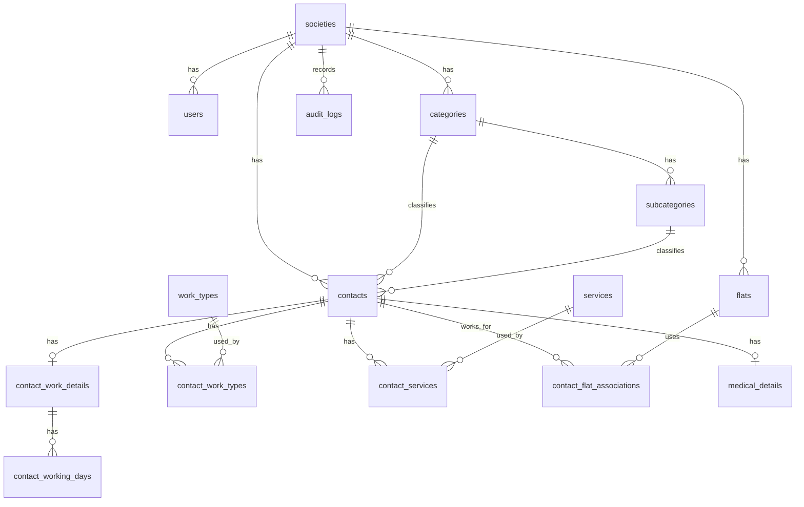

# Society Contact Book Database Design

This project uses MySQL 8, InnoDB tables, Prisma migrations, and normalized relational tables. Every society-specific table carries `society_id` directly or through a required parent relationship so the backend can enforce tenant isolation on every query.

## Main Tables

| Table | Purpose | Key relationships |
| --- | --- | --- |
| `societies` | One row per residential society. | Parent for users, contacts, flats, categories, services, work types, and audit logs. |
| `users` | Login accounts for admins and residents. | Belongs to one society. Roles are `SOCIETY_ADMIN` or `RESIDENT`. |
| `categories` | Contact categories such as Domestic Help, Medical, Maintenance. | Belongs to a society and owns subcategories. |
| `subcategories` | Category-specific subcategories such as Maid, Plumber, Doctor. | Belongs to one category and one society. |
| `contacts` | Core contact identity and required fields from the Word document. | Belongs to society, category, and subcategory. |
| `contact_work_details` | One-to-one optional work detail record for timings, experience, charges, and remarks. | Belongs to a contact. |
| `contact_working_days` | Working days selected for a contact. | Belongs to `contact_work_details`. |
| `work_types` | Multi-select work and availability options. | Linked to contacts through `contact_work_types`. |
| `services` | Named services such as House Cleaning or Plumbing repair. | Linked to contacts through `contact_services`. |
| `flats` | Flats in a society. | Unique by society, building, and flat number. |
| `contact_flat_associations` | Many-to-many link between contacts and flats. | Stores optional relationship, timing, and remarks. |
| `medical_details` | Category-specific fields for Medical contacts. | One-to-one with contacts. |
| `contact_sequences` | Per-society sequence for human-readable contact codes. | Locked in a transaction to safely generate `CNT-000001` style codes. |
| `audit_logs` | Important admin actions. | Records actor, action, entity, and metadata. |

## Design Decisions

Contact codes are separate from internal numeric IDs. The database ID is efficient for joins, while the contact code is friendlier for residents and admins. The backend generates contact codes inside a MySQL transaction using `SELECT ... FOR UPDATE`, preventing duplicate codes during concurrent contact creation.

Work types, services, working days, and flat associations are not stored as comma-separated strings. They use linking tables because a contact can have many work types, a service can apply to many contacts, and a flat can be associated with many contacts.

Medical fields live in `medical_details` instead of the main `contacts` table. This avoids dozens of nullable columns on all contacts and leaves room for future category-specific detail tables.

`Home Visit` is seeded as an additional work type because the Word document examples use it even though the main checklist omits it. The ten explicitly listed work types are still preserved.

## Mermaid ER Diagram

